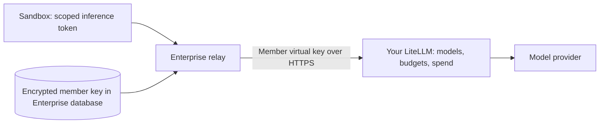
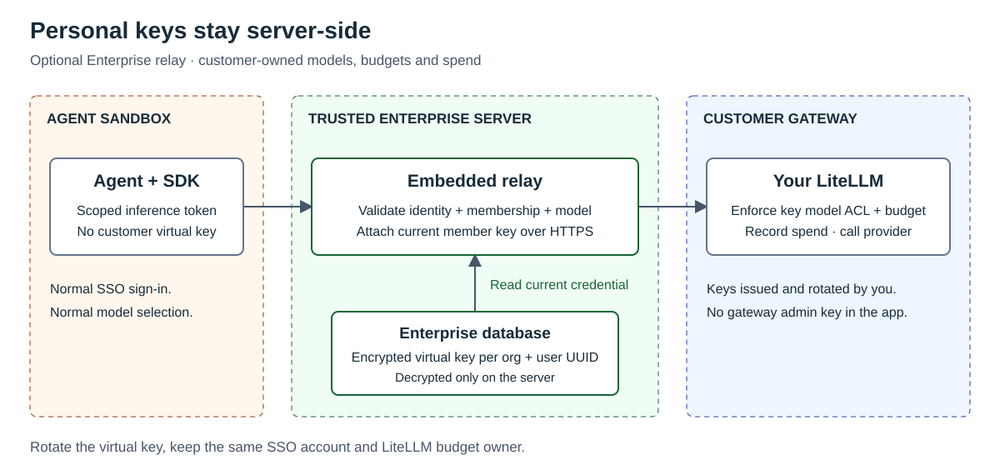
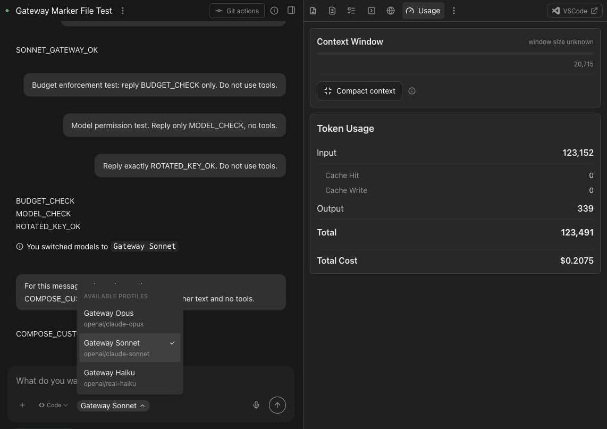

# OpenHands external-gateway evaluation

Buildable Docker Compose preview for **OpenHands Enterprise 1.92.0 / SDK 1.62.0**, tested with **LiteLLM 1.103.6**. This is a controlled customer evaluation, not a supported production release. This private handoff is [owner-authorized](DISTRIBUTION.md); the upstream Enterprise license is retained.

The bundled OpenHands LiteLLM proxy is disabled. An optional relay inside Enterprise uses each member’s existing customer virtual key, stored encrypted server-side. The sandbox receives a short-lived scoped OpenHands token. Your LiteLLM owns user budgets, model permissions and spend reporting.



The SSO identity remains the native OpenHands user ID. Importing a replacement key does not create a new identity. Keep rotated keys attached to the same LiteLLM user to retain that user’s accumulated budget/spend.

## How this changes inference



The relay runs inside Enterprise; there is no separate relay application to deploy. Administrators configure a fixed gateway, shared model catalog and a credential mapping for each member. Developers sign in normally and select keyless model profiles. Setup is explicit in this beta: existing LiteLLM users and keys are not synchronized automatically.

[Compare the earlier two-gateway design with this relay](docs/ARCHITECTURE.md).

## Resume the work without the original conversation

Read [Design decisions](docs/DESIGN-DECISIONS.md) for the alternatives and security rationale, then [Engineering handoff](docs/ENGINEERING-HANDOFF.md) for the code map, tested baseline and production acceptance stages. Live access and deployment details remain in a separate private operator record.

## Repository guide

- [Architecture and exact gateway API permissions](docs/API-PERMISSIONS.md)
- [Product code map](docs/CODE-MAP.md)
- [Current support and next steps](docs/ROADMAP.md)
- [Key/security boundaries](docs/TOPOLOGY.md)
- **[Step-by-step customer setup](docs/SETUP.md)**, [operator commands](cli/README.md), [verification](docs/VERIFICATION.md) and [rollback](docs/ROLLBACK.md)
- [Review](REVIEW.md), [machine-readable Compose evidence](compose-evidence.json), [observed UI](docs/UI.md) and [walkthrough](docs/DEMO.md)

The checked-in source can build the tested beta image locally. No prebuilt beta registry image is included or claimed published. Use the pinned build path below. Evidence uses synthetic test personas; deployment credentials and private infrastructure details are excluded.

## Start a fresh evaluation

Use a dedicated Linux amd64 Docker host, approximately 16 GB RAM, with Docker Engine/Compose v2 and an HTTPS reverse proxy. Do not attach this evaluation to existing production database volumes.

```sh
cp .env.example .env
cp .env.customer-gateway.example .env.customer-gateway
# Set your project name, public app URL and app relay/token URLs.
./build/build.sh
./evaluate config
./evaluate up
```

`./evaluate` includes the security overlay and creates a local mode-0600 `.env.generated-secrets` file. Back it up with the database; **do not delete or regenerate its JWT_SECRET after storing credentials**. It is the application’s encryption/signing secret, distinct from a member’s rotatable LiteLLM key.

For the complete two-member walkthrough—including LiteLLM budgets, secure key import, model profiles and rotation—follow **[the setup guide](docs/SETUP.md)**.

Then configure normal OpenHands authentication and your organization, and follow [the operator guide](cli/README.md) to:

1. Configure the fixed customer gateway URL and shared model catalog.
2. Import each existing member key through stdin using the native user UUID.
3. Create keyless model profiles and activate a default with `bootstrap_default_profile.py`.
4. Run the [verification checklist](docs/VERIFICATION.md).

No Keycloak service or Keycloak-specific backend setting is required. Use your supported identity provider or normal native login.

The default package connects to your existing LiteLLM. `--demo` adds a separate, optional LiteLLM/provider-stub fixture; it does not provision identities or import keys automatically. Real-provider configuration is described in [the provider example](docs/real-provider-example.md).

## What was observed

The AWS native Compose evaluation used two regular SSO members, real Haiku and Sonnet inference, separate personal keys, tool execution, model denial, central budget denial and server-side rotation. The OpenHands conversation UI displayed model profiles, token counts and conversation cost. LiteLLM displayed per-key/per-user spend and the configured user budget.

[Compose evidence](compose-evidence.json), [review](REVIEW.md) and [UI observations](docs/UI.md) describe the exact scope. `EVIDENCE.json` is the separate prior GKE/Helm qualification; its 1,165 passing regressions are not a claim that the entire suite was rerun under Compose.



## Boundaries

- Interactive human conversations are validated. The current code still gates automation and GitLab resolver launches; validating and enabling human-owned workflows with their existing OpenHands identity is the next step. Service accounts require an explicit credential/budget-owner policy. See [the roadmap](docs/ROADMAP.md).
- Warm backends and standalone `CloudWorkspace.get_llm` are refused in this mode.
- Only the OpenAI chat-completions protocol is implemented. Bifrost/Portkey remain unqualified.
- The shared model picker can show a model that a particular member cannot use; permission is enforced when inference runs.
- OpenHands conversation usage is useful feedback. Your gateway remains the authority for total spend and budgets, including auxiliary calls.
- This package adds no sandbox egress firewall, HA or distributed quota system. See [limitations](docs/LIMITATIONS.md).

The original 23 product overlays are unchanged from the live-tested patch. Packaging adds a pinned-base image build, Compose settings and operator tools; there are no SDK or frontend source changes. [Rollback](docs/ROLLBACK.md) preserves data. `HASHES.json` covers the delivered files; no credentials or deployment-specific identifiers are included.

For code review, start with [the code map](docs/CODE-MAP.md) and the patch it links. The overlay directory includes complete upstream files to make guarded image builds reproducible; its line count is not the size of the feature change.
