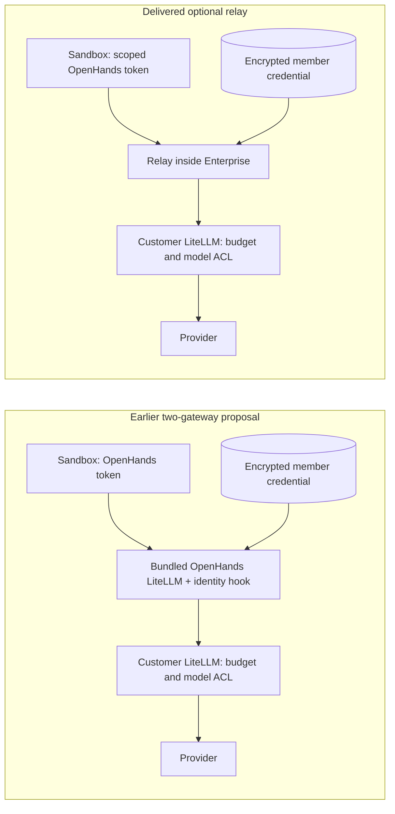
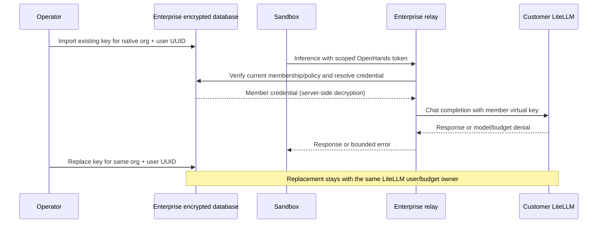

# From two gateways to an Enterprise relay

This comparison describes the earlier proposed two-gateway integration and the delivered beta. It does not claim that every stock OpenHands deployment has the same routing configuration.

Both designs keep the customer virtual key server-side. The beta replaces the bundled gateway/hook with an embedded relay and disables bundled LiteLLM. Customer model access, budgets and spend stay in the customer's gateway. There are no SDK or frontend source changes.

## Identity and rotation

The stable identity is the existing native SSO-backed account, not the key string. The database stores keys using the application's encryption service. Authorized server/database/encryption-secret administrators remain trusted; encryption does not protect against compromise of the application server. The sandbox can use its scoped inference token, so a stolen token is still a limited inference credential until expiry/revocation checks apply. This feature does not add an egress firewall or eliminate prompt-injection risks.

[Exact endpoints and permissions](API-PERMISSIONS.md) · [Code map](CODE-MAP.md) · [Setup](SETUP.md) · [Limitations](LIMITATIONS.md)
