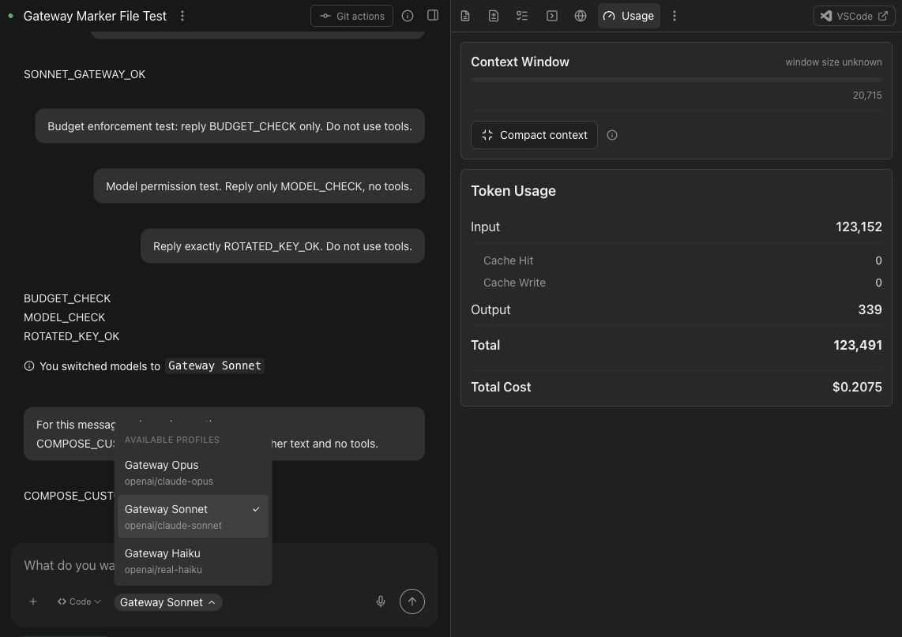
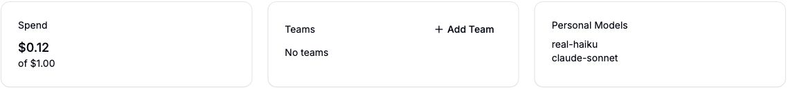
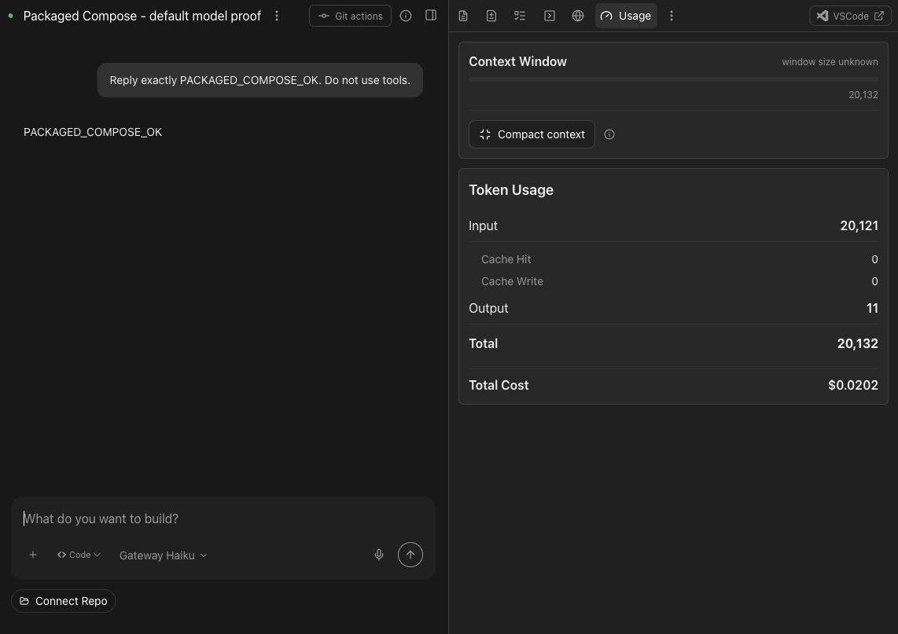

# Observed UI behavior

Verified in native Docker Compose with Enterprise 1.92.0 and Canvas 1.40.0, using regular organization members.

| Surface | Observed behavior |
|---|---|
| New chat / conversation model picker | Shows the organization’s keyless profiles. Haiku and Sonnet selection worked. |
| Selected model label | Persists after switching and reloading when bootstrap profiles store `openai/<alias>` and the app relay URL. No frontend patch was needed. |
| Conversation menu → Display Usage and Cost | Shows input/output/total tokens and conversation cost. The captured run showed 123,491 tokens and $0.2075. |
| Context window | Displayed “window size unknown” for the routing alias. |
| Budget exhausted | Customer LiteLLM’s `ExceededBudget` error appeared in the conversation; inference did not fall back. Recovery worked after restoring the demo budget. |
| Disallowed model | A shared profile remains visible, but the inference request is rejected. |
| LiteLLM virtual keys / internal users | Displayed separate key/user spend, permitted models and the $1 demo user budget. The budget belongs to the customer user, not to one key. |
| LiteLLM request logs | Filtering by the synthetic user showed real model/cost/key-alias rows and the budget-denial record. |

The conversation panel is not an organization-wide billing dashboard and is not expected to equal every auxiliary charge in the gateway. Use LiteLLM for authoritative aggregate spend. Organization billing/usage dashboards in OpenHands were not qualified.

The AWS test used an approved temporary external OIDC provider. No Keycloak service is shipped or required by this package. Members remained regular members.

These are cropped, unaltered captures of synthetic test UI. Credentials, private origins and organization identifiers are outside the captures.

The exact packaged launcher plus corrected operator bootstrap was also verified with two new native API conversations that omitted `llm_profile`. Both returned `PACKAGED_COMPOSE_OK`. The fresh conversation below displayed 20,132 tokens and $0.0202.

